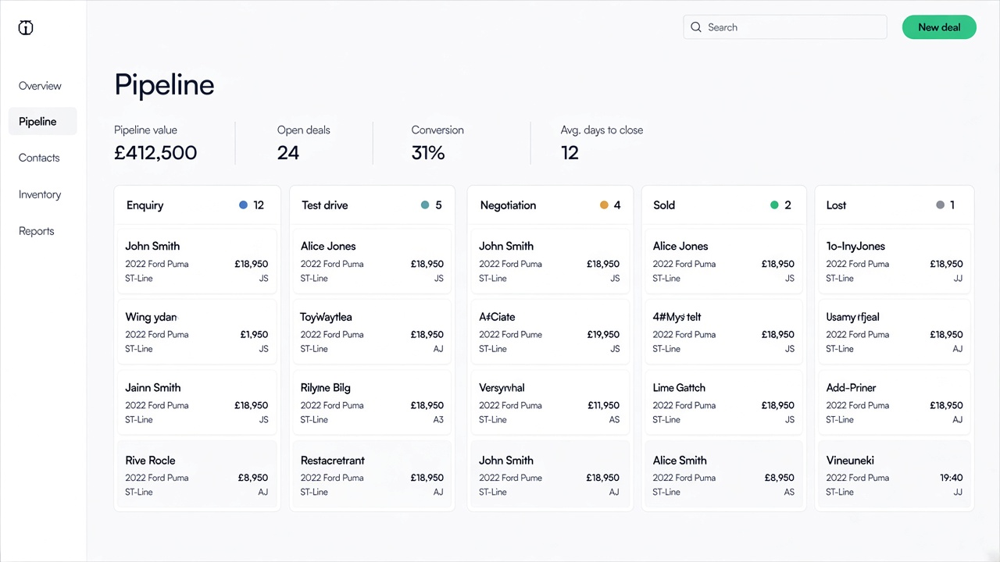
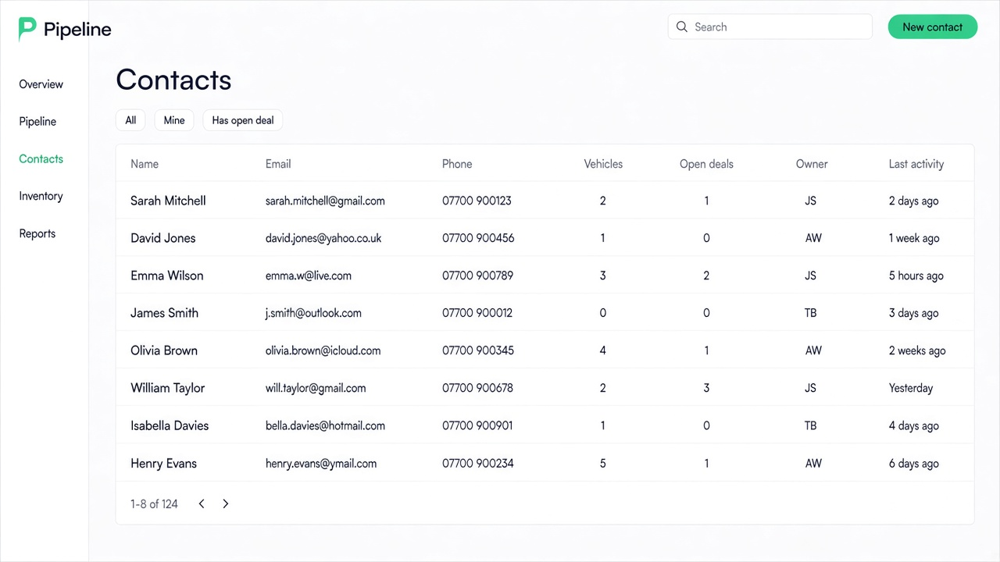
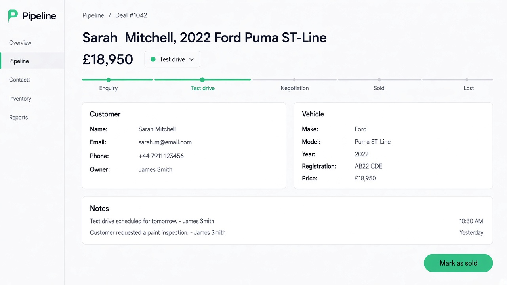

# Dealership CRM

A sales CRM for one car dealership. The dealership stops losing track of leads, and the manager can see where every sale stands without chasing people.





Reps keep their own customers, vehicles, and deals. A manager sees the whole pipeline, from the first enquiry through to sold or lost.

## Stack

- PHP 8.4 and Laravel 13
- Inertia 3, Vue 3, and TypeScript
- Tailwind CSS 4
- Laravel Fortify for session authentication
- Laravel Wayfinder for typed routes
- Pest
- Vite
- SQLite by default

## Architecture

This is a modular monolith. Each area of the business is a top-level folder in `app/`, with its own models, HTTP layer, and policies. There is no separate modules package.

- `app/Core` holds the `User` model and the `Role` enum (`rep`, `manager`).
- `app/Customers` holds contacts. A contact is a customer and never logs in.
- `app/Inventory` holds vehicles. A vehicle belongs to a contact and is listed on that contact's page.
- `app/Sales` holds deals and the `DealStage` enum (`enquiry`, `test_drive`, `negotiation`, `sold`, `lost`). An enquiry is a deal at the enquiry stage.

Vue pages live in `resources/js/pages/customers` and `resources/js/pages/sales`. Feature tests live in `tests/Feature/Customers`, `tests/Feature/Inventory`, and `tests/Feature/Sales`.

Staff sign in. Access is enforced on the server: list queries are scoped, and policies decide who can open a record. Managers see every contact, vehicle, and deal. A rep sees and edits only the contacts they own, the vehicles on those contacts, and the deals they own.

## Local setup

Install PHP dependencies, create the environment file, and generate an application key:

```bash
composer install
cp .env.example .env
php artisan key:generate
```

On Windows, copy the example file with `copy .env.example .env`.

Install the frontend, build it, and load the demo database:

```bash
npm install
npm run build
php artisan migrate:fresh --seed
```

`npm run dev` watches the frontend. `composer run dev` starts the Laravel server, the queue, the logs, and Vite together.

The app is served at the `APP_URL` in `.env`. With `php artisan serve`, that is [http://localhost:8000](http://localhost:8000). A Herd site uses the site hostname instead.

## Demo logins

Every account uses the password `password`.

| Role          | Name           | Email              |
| ------------- | -------------- | ------------------ |
| Manager       | James Whitaker | james@dealer.co.uk |
| Rep           | Priya Shah     | priya@dealer.co.uk |
| Rep           | Owen Clarke    | owen@dealer.co.uk  |
| Rep, inactive | Nia Bennett    | nia@dealer.co.uk   |

The seed creates 40 contacts, 50 vehicles (stock and customer cars), and 60 deals across every stage, with notes and activity. A rep's lists show only their own records. The manager sees all of them. Nia Bennett cannot sign in.

## Next

- Sanctum API
- AI notes summary
